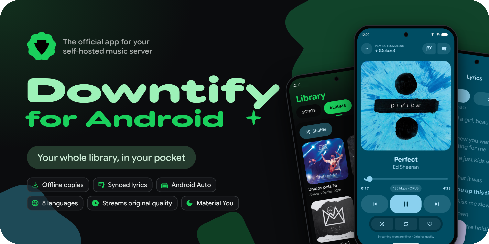

<p align="center">
  
</p>

# Downtify for Android

The official Android client for [Downtify](https://github.com/henriquesebastiao/downtify), the self-hosted music server. It finds your server on the home network (or takes an address you type), signs in with your Downtify account, syncs the library and streams it — original quality on Wi-Fi, transcoded on mobile data — with the system media notification, lock screen and Bluetooth controls.

> [!IMPORTANT]
> This app is currently in the development and testing phase; it will contain bugs. Integration with Downtify is also still being developed and tested.

## Screenshots


# Download

Downtify Android is available on GitHub Releases page.  

[](https://github.com/henriquesebastiao/downtify-android/releases)
[](https://apps.obtainium.imranr.dev/redirect?r=obtainium://app/%7B%22id%22%3A%22com.henriquesebastiao.downtify%22%2C%22url%22%3A%22https%3A%2F%2Fgithub.com%2Fhenriquesebastiao%2Fdowntify-android%22%2C%22author%22%3A%22henriquesebastiao%22%2C%22name%22%3A%22Downtify%22%2C%22preferredApkIndex%22%3A0%2C%22additionalSettings%22%3A%22%7B%5C%22includePrereleases%5C%22%3Afalse%2C%5C%22includeDrafts%5C%22%3Afalse%2C%5C%22fallbackToOlderReleases%5C%22%3Atrue%2C%5C%22filterReleaseTitlesByRegEx%5C%22%3A%5C%22%5C%22%2C%5C%22invertReleaseTitlesFilter%5C%22%3Afalse%2C%5C%22filterReleaseNotesByRegEx%5C%22%3A%5C%22%5C%22%2C%5C%22invertReleaseNotesFilter%5C%22%3Afalse%2C%5C%22verifyLatestTag%5C%22%3Afalse%2C%5C%22sortMethodChoice%5C%22%3A%5C%22date%5C%22%2C%5C%22useLatestAssetDateAsReleaseDate%5C%22%3Afalse%2C%5C%22releaseTitleAsVersion%5C%22%3Afalse%2C%5C%22versionExtractionRegEx%5C%22%3A%5C%22%5C%22%2C%5C%22matchGroupToUse%5C%22%3A%5C%22%5C%22%2C%5C%22versionDetection%5C%22%3Atrue%2C%5C%22releaseDateAsVersion%5C%22%3Afalse%2C%5C%22useVersionCodeAsOSVersion%5C%22%3Afalse%2C%5C%22apkFilterRegEx%5C%22%3A%5C%22%5C%22%2C%5C%22invertAPKFilter%5C%22%3Afalse%2C%5C%22autoApkFilterByArch%5C%22%3Atrue%2C%5C%22includeZips%5C%22%3Afalse%2C%5C%22zippedApkFilterRegEx%5C%22%3A%5C%22%5C%22%2C%5C%22includeTarballs%5C%22%3Afalse%2C%5C%22tarballedApkFilterRegEx%5C%22%3A%5C%22%5C%22%2C%5C%22minimumUpdateAgeDays%5C%22%3A%5C%22%5C%22%2C%5C%22exemptFromBackgroundUpdates%5C%22%3Afalse%2C%5C%22skipUpdateNotifications%5C%22%3Afalse%2C%5C%22refreshBeforeDownload%5C%22%3Afalse%2C%5C%22detectionDateAsReleaseDate%5C%22%3Afalse%2C%5C%22trackOnly%5C%22%3Afalse%2C%5C%22appName%5C%22%3A%5C%22%5C%22%2C%5C%22appAuthor%5C%22%3A%5C%22%5C%22%2C%5C%22shizukuPretendToBeGooglePlay%5C%22%3Afalse%2C%5C%22allowInsecure%5C%22%3Afalse%2C%5C%22allowedSigningCertHashes%5C%22%3A%5C%22%5C%22%2C%5C%22about%5C%22%3A%5C%22%5C%22%2C%5C%22updateHealthStaleRelease%5C%22%3A%5C%22%5C%22%2C%5C%22updateHealthStaleVersion%5C%22%3A%5C%22%5C%22%2C%5C%22updateHealthFailedChecks%5C%22%3A%5C%22%5C%22%2C%5C%22updateHealthArchived%5C%22%3A%5C%22%5C%22%2C%5C%22updateHealthFilteredReleases%5C%22%3A%5C%22%5C%22%2C%5C%22github-creds%5C%22%3A%5C%22%5C%22%2C%5C%22GHReqPrefix%5C%22%3A%5C%22%5C%22%2C%5C%22checkRepoRename%5C%22%3Afalse%7D%22%2C%22overrideSource%22%3A%22GitHub%22%7D
)

## Android Auto

Android Auto can browse playlists, liked songs, artists, albums, tracks and completed offline downloads through the app's media library. Set up and sync the app on the phone first, then open **Downtify** in Android Auto's launcher. A separate test build may be named **Downtify Preview**.

**Installing an APK from GitHub, Obtainium or a download link:** Android Auto may hide it until its own **Unknown sources** developer option is enabled. Allowing Android to install APKs is a different setting. While parked:

1. Open Android Auto settings on the phone and scroll to **Version**. Tap it to show the version/permission information, then tap that section ten times to enable developer settings; confirm if asked.
2. In the overflow menu, open **Developer settings** and enable **Unknown sources**.
3. Open **Customize launcher**, check **Downtify** (or the installed test build's name), then reconnect Android Auto.

This is an Android Auto installation-source requirement; signing an APK or changing the app's code cannot remove it. Google's supported alternative is installation from a trusted source, such as Google Play, including an internal test track. See the [official testing requirements](https://developer.android.com/training/cars/testing#unknown-sources). This does not announce a Play Store release of Downtify.

Opening the library does not start music. Android Auto/your receiver chooses the last media source and requests playback; Downtify does not force itself over another player. See [Android Auto setup, troubleshooting and validation](docs/android-auto.md) for missing apps, resumption and tests.

## Android TV and Fire TV

The same APK installs on Android TV, Google TV and Amazon Fire TV (Fire OS 7 or newer; Fire OS 6 is Android 7.1, below the app's Android 8), where it shows in the launcher with its own banner. It is driven by the remote: the D-pad moves a ring from button to row, OK picks, Back goes back. Opening Now Playing puts the focus on play/pause and keeps it there until Now Playing closes; the queue, the lyrics and the side menu do the same. To reorder the queue, focus a song's handle, press OK to pick it up, move it with up and down, and press OK to put it down (Back puts it back). A TV has no camera, so it pairs with the 8-character code typed on the screen keyboard, or with the account's password. To install it on a TV (with ADB, from a phone with Tellyscope, or on the TV with Downloader), see [Installing on a TV](docs/tv-installation.md).

On a TV the app has an interface of its own, after the TV music apps, over the same data and player as the phone: a top bar with what's playing on the left (OK opens the player), Home, Search and Library in the middle and Settings on the right; Home as wide tiles to jump back in and rows of covers; the library as a wide grid of covers (round for artists) with its sections as pills; an album or a playlist with its cover and details on the left and its songs on the right (Right on a song reaches its "Add to queue" button; the one beside shuffle queues the whole album or playlist), the one playing marked by the playing bars, as in what's-playing on the top bar; an artist with their photo (the one the server has for them, else one of their covers) in a large circle, their name, shuffle and play on the left and, on the right, their songs (each with its album) or their albums, switched by pills; the focused row scrolling to the top and the focus drawn as a ring a little away from what it surrounds, along its shape. The player fills the screen with the artist's hero banner, the one the web app shows over their page (the cover when the server has none), the title at the bottom left, the seek bar (left and right seek 10 s), the transport and the lyrics and queue buttons; while music plays and no key is pressed, the controls fade after a few seconds and the next key brings them back. Lyrics show in the player itself, on the cover's color, the line being sung bright near the top; near the end of a song, what plays next shows at the top right. The queue opens as a panel down the right of the player: what's playing with a button to skip it, then what comes next; OK on a song plays it. Dark mode, for a dark room, takes the picture away and dims the screen, more once the controls fade. Below the controls, "About the artist" peeks in and slides up when focused: the artist in a circle and a button to their page. Discover, podcasts, similar songs from Home, Downloads and the trash stay on the phone. Back on Home while music plays asks first whether to close the app, which stops the music. Search has a wide field and the filters at the top and its results as rows of covers under them, the library's first and then what the server found (to play in full); the field opens the keyboard on OK, and Up and Down always leave it. Settings lay their sections down the left and the options of the focused one on the right, choices opening as short lists; what a TV has no use for (the floating navigation bar, mobile data, offline downloads, the server's web page) isn't there. On a TV the app has a 16:9 banner for Android TV's launcher and a square icon, the logo over its name on near-black, for Fire TV's, which shows an app installed outside its store by its icon, in a square on a grey tile (Fire TV keeps the icon it read at the first install: a new one only shows after uninstalling and installing the app again), and the launch screen is black. Phones and tablets keep their layout, icon and launch screen.

## Languages, fonts and theme

- **Languages:** the same eight as the Downtify web app — Bulgarian, English, French, Greek, Hungarian, Portuguese (Brazil), Spanish and Turkish. The app follows the phone's language and falls back to English when it isn't one of these. On Android 13+ the language can also be set per app (**Settings › Appearance › Language** opens Android's own screen for it).
- **Fonts** (Settings › Appearance › Font): Google Sans Flex in its rounded cut, as on Pixel phones (the default), Downtify classic (Sora and DM Sans) or the system font. Google fonts are fetched by Play services. Sora and DM Sans also ship in the app, so Downtify classic works without Play services too (Fire TV, de-Googled phones), where Google Sans Flex falls back to the system font. On a TV the font is Downtify classic and the theme dark until others are picked (Fire TV reports day, which made the first screens white).
- **Theme:** follow system, dark or light, optional wallpaper colors (Android 12+) and **Pure black** for OLED screens in the dark theme.
- **About** (Settings › About Downtify): version (tap to copy), bug reports, source code, the GPL-3.0 license, the terms and disclaimer, and ways to support the project.

## Playback level

Settings → Playback → loudness normalization offers Normal, Louder and Maximum, with measured peak protection. See [playback level](docs/volume-and-server-pause.md).

## Requirements

- JDK 17 or newer (the build targets Java 17).
- Android SDK with platform 37 (`compileSdk`/`targetSdk` 37, `minSdk` 26). Gradle installs missing platforms on first build when `sdk.dir` in `local.properties` points at a writable SDK.
- A Downtify server **3.1.0 or newer** (mobile API v1, pairing). Signing in with a username and password needs a server newer than 3.7.0 (`password_sign_in` in `GET /api/server/info`); older ones pair with a code.

## Build

```bash
./gradlew assembleDebug          # app/build/outputs/apk/debug/app-debug.apk
./gradlew installDebug           # onto a connected device or emulator
./gradlew build                  # everything: compile, unit tests, Android lint
./gradlew detekt spotlessCheck   # static analysis and formatting
./gradlew spotlessApply          # fix formatting
```

The debug build installs as `com.henriquesebastiao.downtify.debug`, so it sits next to a release build. Working on the TV interface: [Developing and testing on a TV](docs/tv-development.md) shows how to build, drive and check it on a real TV over ADB. `assembleRelease` is signed with the debug key (there's no release keystore in the repo) — replace the signing config before shipping.

## Pointing it at a server

1. Run Downtify (`make run` or Docker). Note the address you open it at in a browser, e.g. `http://192.168.1.20:8000`.
2. Open the app. Allow **nearby devices / local network** access when asked (Android 17+ needs it to reach anything on your home network).
3. Pick the server under **Found on this network**, or type its address. `192.168.1.20:8000` is enough; `http://` is added for you. HTTPS addresses work too, including behind a reverse proxy with a private CA installed on the phone.
4. Sign in with the username and password you use on the web page. The phone becomes one of that account's paired apps; the password isn't kept on the phone.

   Or pair instead, without typing the password: on the web page, signed in as the account the phone should belong to, open **Settings → Apps → Pair a phone**, then scan the QR code (from the first screen, or **Use a pairing code instead**) or type the 8-character code. A server with sign-in turned off, or older than app sign-in, goes straight to the code.

Notes:

- **Docker:** the default bridge network doesn't carry mDNS, so the server won't show up under "Found on this network". Type the address, or run the container with `network_mode: host`.
- **Emulator:** the host machine is `10.0.2.2` (`http://10.0.2.2:8000`).
- **Plain http** is allowed for any address, because self-hosted servers are usually `http://` on the LAN and Android's network security config can't express "private addresses only". Over http the password and the device token travel unencrypted: fine at home, not across the internet. The connect and sign-in steps warn about a plain-http public address. See `app/src/main/res/xml/network_security_config.xml`.
- **Unpairing** from the web (Settings → Apps → the phone → Unpair) stops playback and sends the app back to the connect screen. **Sign out** in the app's Settings forgets the token on the phone; the web page keeps listing the phone until it's unpaired there.

## Project layout

| Module | What's in it |
|---|---|
| `:app` | Activity, navigation, all screens (`feature/*`), strings |
| `:core:model` | Pure Kotlin: domain types and logic (address normalising, pairing URI, stream policy, grouping, listen counter, LRC parser, search) |
| `:core:network` | OkHttp/Retrofit client for the contract, NSD discovery, WebSocket, Keystore-encrypted session store |
| `:core:data` | Room (library, playlists, likes, recents, listen queue, offline index), DataStore settings, sync, offline downloads, the listen flusher (WorkManager), server search and the server's download queue |
| `:core:player` | Media3 `MediaSessionService`, stream URL resolving, cache, listen and activity tracking, UI-side `PlayerController`, the preview player |
| `:core:designsystem` | Material 3 theme (brand tokens, dark/light, dynamic color), fonts, icons, logo, shared components |
| `build-logic` | Gradle convention plugins |

Conventions for working on the code are in [CLAUDE.md](CLAUDE.md). The server contract the app implements lives in the server repository: `docs/mobile-client-contract.md`.

## Credits

The app follows Material 3 Expressive. Several of its components take their design from [PixelPlayer](https://github.com/PixelPlayerHQ/PixelPlayer), a Material 3 Expressive music player for Android by [theovilardo](https://github.com/theovilardo) and [contributors](https://github.com/PixelPlayerHQ/PixelPlayer/graphs/contributors). Its free and open-source edition is [PixelPlayerOSS](https://github.com/PixelPlayerHQ/PixelPlayerOSS), under GPL-3.0. Thank you for the inspiration.

Inspired by PixelPlayer:

- the type scale with Google Sans Flex's rounded cut, the large page titles and the wide hero title;
- page headers with round back and action buttons, the tinted Library header and its pill tabs;
- grouped lists with large outer and small inner corners, and the settings' value tags;
- the floating navigation bar, with the option of a full-width one;
- the side menu opened from Home's menu button;
- the library's one-row title, its icon buttons, its sort sheet and its scrollbar;
- the song that's playing drawn as a pill with a round cover;
- the mini player:
  - joined to the floating bar as one group;
  - its title sliding when it doesn't fit;
  - its previous, play/pause and next buttons;
- Now Playing and the mini player in the colors of the cover.

These are designs, not code: Downtify implements them in its own components (`:core:designsystem`) and includes no PixelPlayer source.

## License

GPL-3.0 — see [LICENSE](LICENSE).

Android Auto stability: see [the diagnostic and receiver acceptance checklist](docs/android-auto.md#stability-follow-up-full-phone-freeze-report). Launcher visibility and unit tests alone do not validate a full-phone freeze fix.
